# FieldTask Pro

FieldTask Pro est une application Flutter Android de suivi des interventions terrain pour les techniciens TechFix. Elle permet de consulter les tâches affectées, de saisir le travail réalisé et de conserver les changements sur l’appareil quand le réseau est indisponible. Une API REST Spring Boot et MySQL reçoit ensuite les modifications.

> Projet académique et démonstrateur local. Les identifiants et secrets fournis par Docker Compose sont réservés au développement; ne les réutilisez pas en production.

## Captures de l’application

Les captures ci-dessous montrent les principaux écrans. Les fichiers originaux fournis pour le projet sont conservés dans [`assets/screenshots/`](assets/screenshots/).

| Écran | Aperçu |
|---|---|
| Connexion | 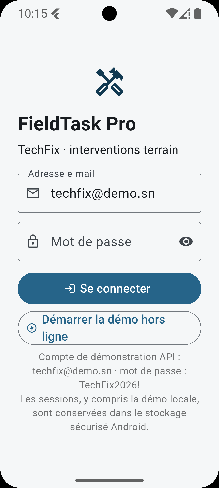 |
| Tableau de bord hors ligne | 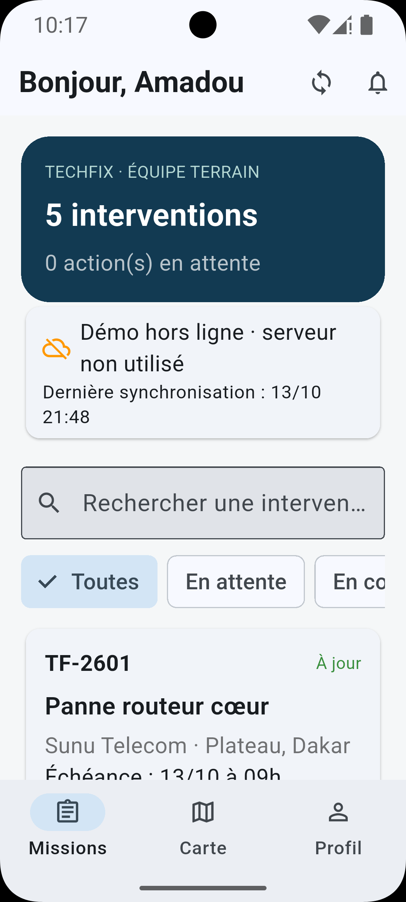 |
| Tableau de bord connecté | 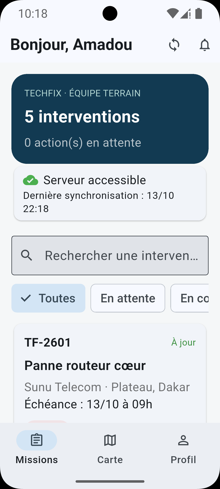 |
| Carte des interventions | 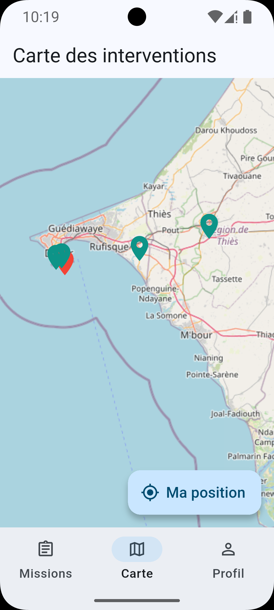 |
| Profil technicien | 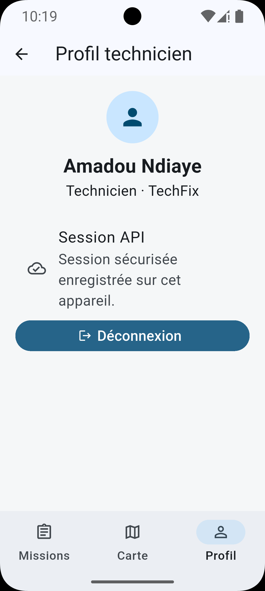 |
| Rappels programmés | 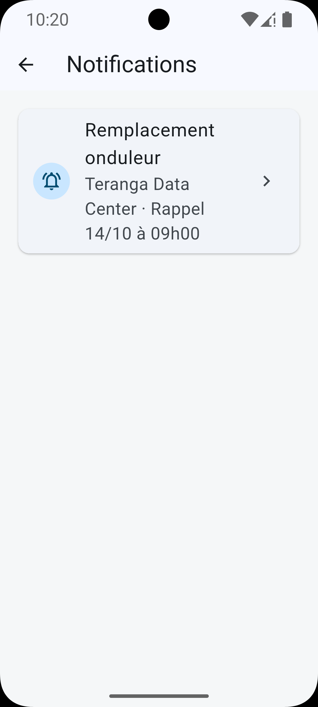 |
| Intervention affectée et rappel | 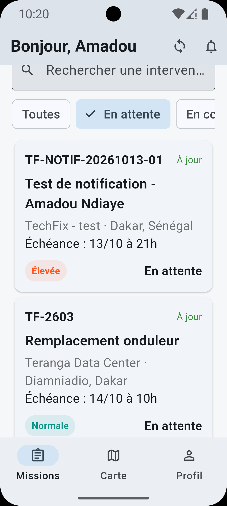 |
| Détail d’une intervention | 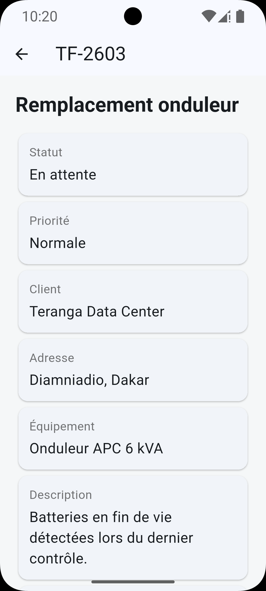 |
| Actions de terrain | 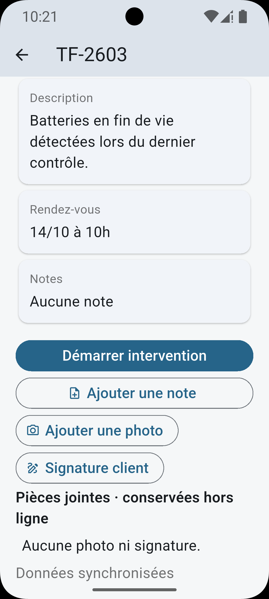 |
| Signature du client | 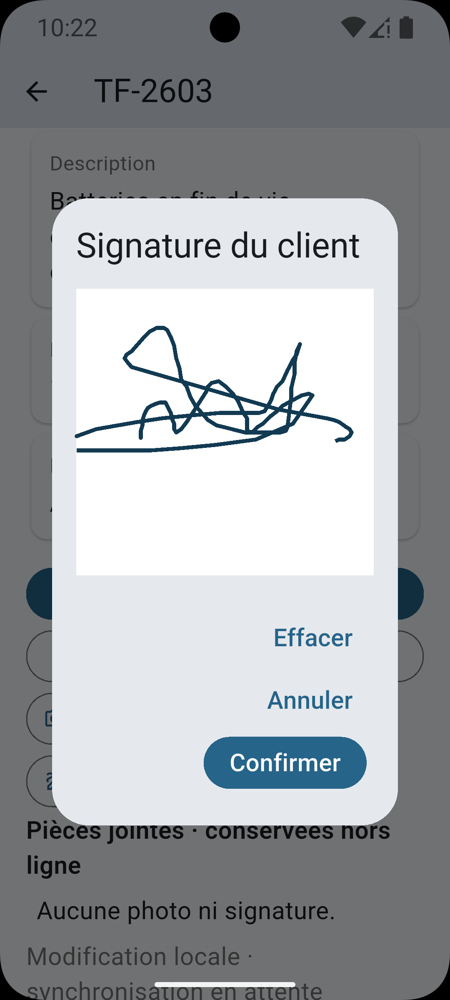 |
| Pièces jointes hors ligne | 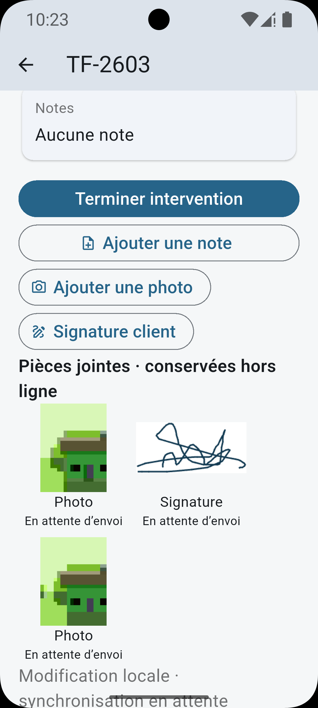 |
| Intervention terminée | 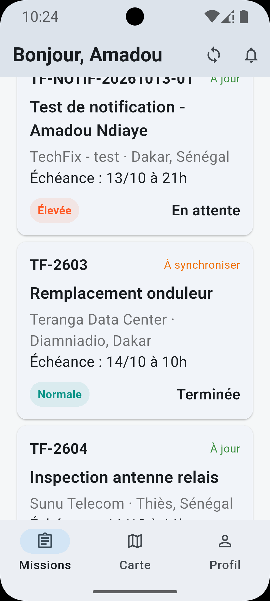 |
| Tableau de bord après intervention | 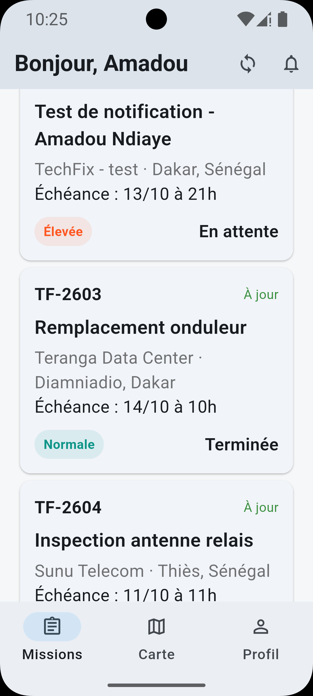 |
| Accès au détail depuis un marqueur | 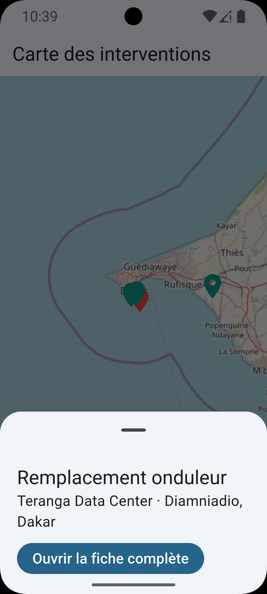 |

## Fonctionnalités

- Connexion à l’API et session conservée dans le stockage sécurisé de l’appareil; mode démo local distinct.
- Tableau de bord limité aux interventions du technicien connecté, avec filtres par statut, tri par priorité, recherche dynamique et état du serveur.
- Détail des interventions, transition de statut, notes, photos et signature du client.
- Stockage local SQLite et file d’attente persistante pour les changements à synchroniser.
- Synchronisation REST avec identifiants d’opération stables, reprises après erreur et gestion des conflits.
- Carte des interventions avec position GPS. Les tuiles OpenStreetMap demandent une connexion Internet.
- Rappels locaux des échéances et page Notifications; toucher un rappel ouvre l’intervention correspondante.

## Architecture

Le code Flutter est organisé par fonctionnalité. Chaque feature applique les trois couches **Presentation**, **Domain** et **Data** :

```text
lib/
├── app/                         # Routes, composition et injection des dépendances
└── features/
    ├── auth/{data,domain,presentation}
    ├── interventions/{data,domain,presentation}
    ├── map/{data,domain,presentation}
    ├── notifications/{data,domain,presentation}
    └── synchronization/{data,domain}

backend/                         # API REST Spring Boot et scripts SQL
test/                            # Tests domaine, Cubits et widgets
assets/screenshots/              # Captures d’écran intégrées à ce README
```

**Presentation** contient les pages et Cubits BLoC. **Domain** déclare les entités, règles, contrats et cas d’usage, sans dépendre des plugins. **Data** implémente les contrats avec SQLite, l’API REST, le stockage sécurisé et les services Android.

## Technologies

- Flutter et Dart, `flutter_bloc`, `go_router`, `get_it`
- SQLite avec `sqflite`; appels HTTP avec Dio
- Spring Boot 3.4.4, Spring JDBC, Java 17 et MySQL 8.4
- Docker Compose pour MySQL, l’API et phpMyAdmin
- `flutter_map`, OpenStreetMap et `geolocator`
- `image_picker`, `signature`, `flutter_local_notifications` et `timezone`

## Démarrage local

### 1. Démarrer l’API et la base de données

Installer et démarrer Docker Desktop, puis lancer à la racine du projet :

```powershell
docker compose up --build
```

Services exposés sur la machine :

| Service | Adresse |
|---|---|
| API Spring Boot | `http://localhost:8080` |
| Vérification de santé | `http://localhost:8080/api/health` |
| MySQL | `localhost:3307` |
| phpMyAdmin | `http://localhost:8081` |

Le port hôte `3307` évite un conflit avec un MySQL local utilisant `3306`. Dans phpMyAdmin, choisissez le serveur `mysql` et la base `fieldtask`. Les identifiants Compose sont des valeurs de démonstration uniquement.

### 2. Installer et lancer Flutter

Dans un autre terminal, depuis la racine du projet :

```powershell
flutter pub get
flutter analyze
flutter test
flutter run --dart-define=API_URL=http://10.0.2.2:8080
```

`10.0.2.2` permet à l’émulateur Android d’atteindre le PC hôte. Sur un téléphone physique, remplacer cette adresse par l’adresse IP locale du PC, par exemple `http://192.168.1.20:8080`.

Le seed local crée un compte technicien de démonstration dans MySQL. Utilisez les identifiants de démo du seed et ne réutilisez pas ces valeurs pour un vrai compte. Le mode « Démarrer la démo hors ligne » ne contacte pas l’API.

## Vérification et limites

Au 13 octobre 2026, l’analyse Dart et les 20 tests Flutter étaient réussis. L’exécution Android après les dernières modifications, la livraison effective des notifications Android et les essais complets de synchronisation contre MySQL restent à vérifier sur l’installation locale. Le dépôt ne fournit pas de cible iOS.

Pour le détail des exigences et leur état, consulter [`docs/suivi_exigences.md`](docs/suivi_exigences.md). Pour les choix d’architecture et de synchronisation, voir [`docs/architecture.md`](docs/architecture.md) et [`docs/synchronisation_offline.md`](docs/synchronisation_offline.md).
